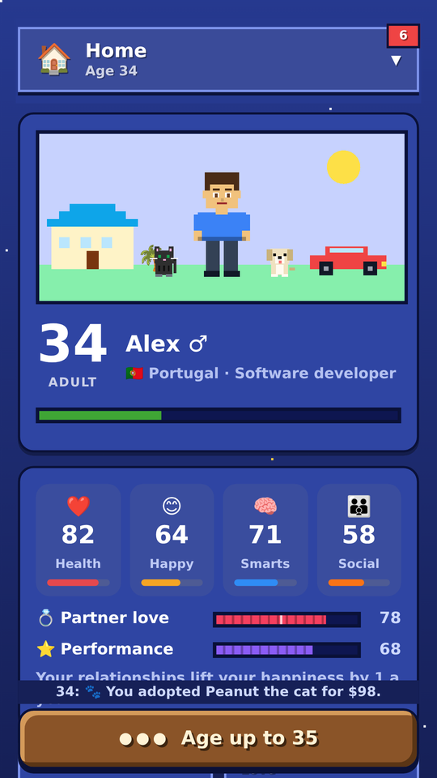
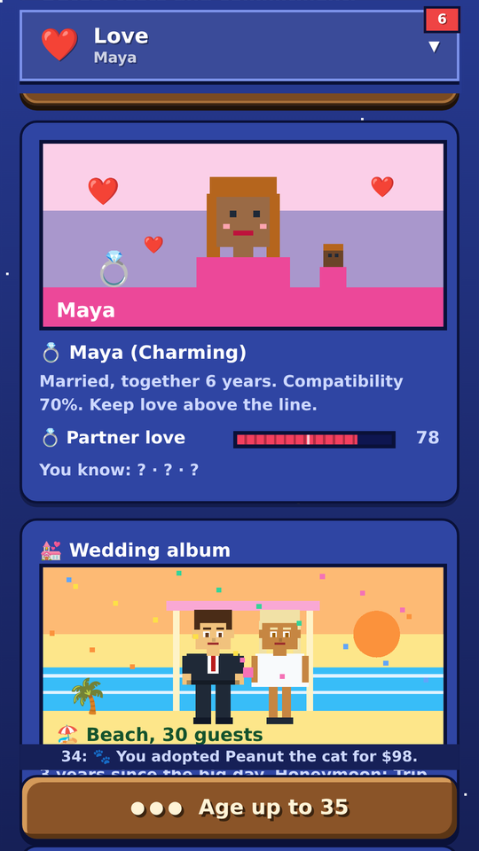
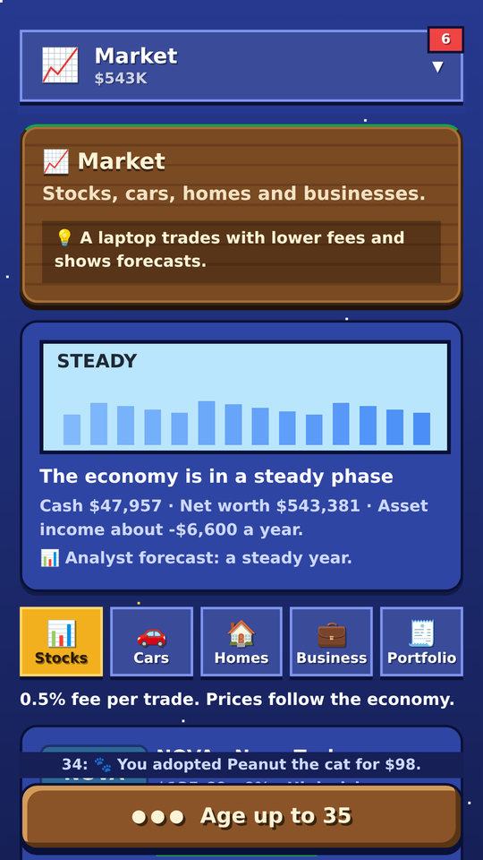
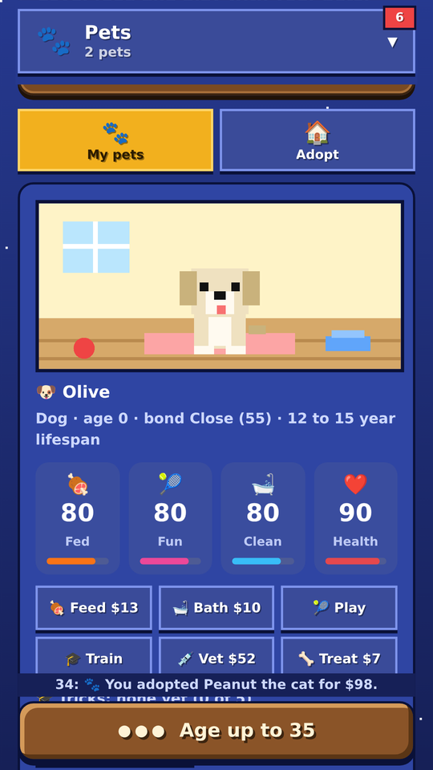

# Life Sim

Live a whole life, one year at a time. Life Sim is a browser life-simulation game: pick your look, country and traits, then make choices from birth to old age.

## Features

- Character creator: skin, hair, eyes, clothes and accessories
- 38 countries with different pay, costs, taxes and healthcare
- School years, college with GPA, and many careers with promotions
- Love, engagement, weddings, children, and playing on as your heir
- A market with stocks, cars, homes and businesses
- Pets to adopt, groom, train and show
- World travel, storylines and a bucket list
- Needs, skills, wishes, challenges and pop-up celebrations
- 10 dark and light colour themes, three difficulty levels
- Works offline and can be installed as an app

## Play it

- Online: if you turned on GitHub Pages, your game is at `https://YOUR-USERNAME.github.io/life-sim/`
- On your computer: open `index.html` in a browser, or run `python3 -m http.server` in this folder and visit `http://localhost:8000`

## How it is built

One self-contained `index.html` with no dependencies, plus a small manifest and service worker so it can be installed and played offline.

## Privacy

The game collects no personal data. See `privacy-policy.html`.

## License

Add a license file if you want others to reuse the code (for example, MIT).
